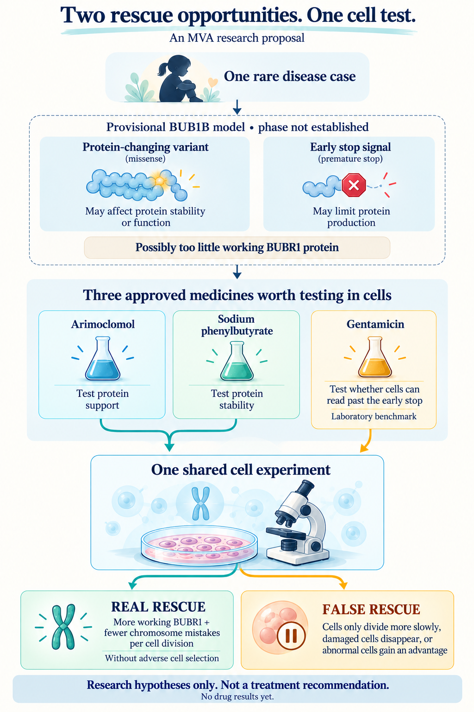
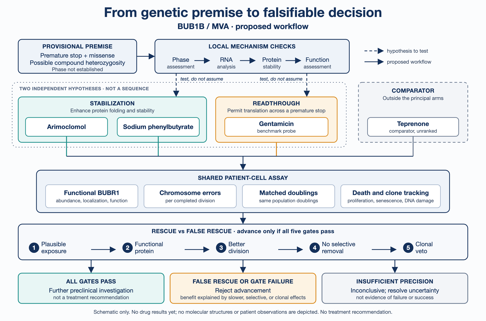

# Real rescue, not false rescue
## Three approved medicines, two BUB1B rescue opportunities, one discriminating cell experiment

**MVA Hackathon 2026 · Track 2 · Drug Repurposing**

*19 October 2026*

## 1. Executive summary

When a cell divides, it must distribute its chromosomes correctly. BUB1B makes BUBR1, a protein that helps this process work reliably. The Track 1 analysis ranked one genetic model first for this child's mosaic variegated aneuploidy (MVA), a rare chromosome-instability and cancer-predisposition syndrome: **one premature-stop lesion and one missense lesion in BUB1B, with possible compound heterozygosity; phase is not established**. This suggests two conditional opportunities: stabilize residual BUBR1 if instability is the defect, or promote full-length protein production if enough stop-bearing RNA remains.

This proposal prioritizes **arimoclomol** and **sodium phenylbutyrate** as protein-stabilization hypotheses, and **gentamicin** as a stop-allele readthrough benchmark. All three are marketed medicines for other indications. None has demonstrated rescue in this case. Teprenone accompanies them as an unranked comparator.

One shared patient-cell experiment applies a strict rule: **restore functional BUBR1 and reduce chromosome errors per completed division, without merely slowing growth, killing abnormal cells, or favoring abnormal clones.** The first decision is whether the cells contain a rescuable substrate; baseline RNA, protein turnover, and function determine which drug arms proceed. The advancement gates then exclude misleading improvement; an informative negative result is itself a finding.

**This is a laboratory research proposal for expert review, not a recommendation to treat the child. No patient-cell drug results are reported.**

*Figure 1. Two provisional BUB1B lesion classes suggest two rescue opportunities. Three approved medicines are proposed for testing in one shared cell experiment designed to distinguish real from false rescue. Icons are schematic; the child silhouette is fictional.*

## 2. From provisional mechanism to testable branches

BUBR1 helps prevent premature chromosome separation and supports chromosome-spindle attachments. Loss of these functions can generate daughter cells with abnormal chromosome numbers. The two lesion classes suggest different routes toward restoring function; neither molecular consequence is yet established in this case.

**Mechanism in brief (provisional).** If the two lesions are in trans, the predicted mechanism is recessive loss of BUBR1 function, impairing the spindle-assembly checkpoint and kinetochore-microtubule attachment; the downstream consequence would be chromosome missegregation and mosaic aneuploidy. Each element is a prediction to be tested (Section 5), not an established finding.

| Lesion class | Testable consequence | Rescue opportunity | First question |
|---|---|---|---|
| Missense | Protein may be unstable, incorrectly localized, or intrinsically dysfunctional | Stabilize **functional** residual BUBR1 | Does restoring abundance also restore function? |
| Premature stop | RNA may undergo nonsense-mediated decay (NMD); escaping RNA may produce truncated protein | Induce readthrough to make functional full-length BUBR1 | Is sufficient RNA available, and is the readthrough product functional? |

Suijkerbuijk et al. studied MVA patient cells: the truncating alleles assessed gave little or no detectable transcript (consistent with NMD), and kinase-domain missense proteins showed low abundance and increased turnover. In selected missense mutants, instability was HSP90-dependent, and restoring two unstable mutants to normal abundance restored checkpoint responses. Other mutants had direct functional defects. A HeLa depletion experiment found near-normal segregation at approximately 13% BUBR1 but severe errors at approximately 6%. This motivates partial rescue, **not a universal therapeutic threshold or a proven mechanism here**. These published patterns are treated as priors to test in this case, not assumptions. [1]

**First decision: is there a rescuable substrate?** Before drug testing, authorized laboratory work must establish phase, RNA availability, protein turnover, and baseline function. BUB1B normally has two copies; the proposed recessive model depends on the lesions affecting different copies. Exact sequences and allele-level results are withheld to protect the family's privacy.

| Baseline finding | Consequence for the proposal |
|---|---|
| Low BUBR1 abundance with increased turnover, and recoverable function | Prioritize the stabilization arms; abundance alone is insufficient. |
| Detectable stop-bearing RNA | Retain the gentamicin readthrough arm; verify the identity and function of any full-length product. |
| Little or no stop-bearing RNA | Deprioritize gentamicin under this design; do not infer that every readthrough strategy is ineffective. |
| Normal abundance with an intrinsic functional defect, or lesions in cis | Reassess the stabilization rationale or the recessive genetic model before advancing it. |

If baseline findings support neither arm, stop this screen and reassess the mechanism; unresolved measurements remain inconclusive.

These are proposed branching decisions, not observations from this child's cells.

## 3. Ranked approved-drug shortlist

**Rank means priority for ex vivo testing.** Evidence is separated into direct BUBR1 biology, evidence in another disease, and the untested bridge to this case.

| Priority and role | Approved/marketed use | Hypothesis and evidence | Main reason it could fail |
|---|---|---|---|
| **1 · Arimoclomol** | US-marketed Miplyffa; FDA-approved in 2024 with miglustat for NPC neurological manifestations, age ≥2. EU authorization is not established; CHMP issued a negative opinion in July 2026 and the sponsor requested re-examination. [2-4] | Amplify a pre-existing heat-shock response → support folding/stability of missense BUBR1. HSP90 dependence is direct BUBR1 evidence [1]; arimoclomol proteostasis effects come from other models [5]. **BUBR1 rescue remains inference.** | HSP70-oriented activity may not support the required HSP90-dependent function. Chaperones can rise without BUBR1 or fidelity improving. |
| **2 · Sodium phenylbutyrate (4-PBA)** | US/EU-authorized UCD medicine, with chronic pediatric use; sodium formulations such as Pheburane remain marketed. [8-10] | Support residual protein folding/stability. Rescue of selected mutant MCT8 proteins provides another-disease precedent [11]; activity on cytosolic BUBR1 is untested. | Brief exposure may be inadequate. HDAC activity may alter mitosis and create apparent rescue. |
| **3 · Gentamicin - benchmark** | Marketed injectable aminoglycoside for serious bacterial infections, including pediatric use. [13] | Promote premature-stop readthrough. Human DMD studies detected variable dystrophin increases, reaching 13-15% of normal in some participants [14]; BUB1B readthrough is untested. | Sequence dependence, limited RNA, or a dysfunctional inserted residue; nephrotoxicity and ototoxicity make chronic translation unattractive. |

**Teprenone: comparator, not a fourth principal.** Japan-marketed Selbex offers a distinct heat-shock hypothesis, without demonstrated BUBR1 rescue. Its adult label uses 150 mg/day in divided doses; pediatric trials were not conducted. A 50 mg study found Cmax ≈0.75 µM; the label reports ≈6.6 µM after a **single 150 mg fed dose**, which does not represent routine divided dosing. Human atrial HSP induction was studied at 400 mg/day. Its exposure limitation is regimen-dependent. [16-18]

## 4. Why these three candidates survived

**How candidates were selected.** The approved-drug candidate universe was generated through LLM-assisted literature discovery around BUBR1 stability, translational readthrough, and chromosome-segregation biology. Candidates were then screened using public drug labels, regulatory records, and primary literature for mechanism, directionality, approval status, human exposure, and safety. This was a targeted evidence review rather than a systematic review. The shortlist in Section 3 records each candidate's rationale, evidence boundary, and principal failure mode; it does not establish exhaustive coverage of approved medicines.

Approval is not evidence of efficacy in MVA.

**Arimoclomol leads on exposure plausibility.** Labeled pediatric Cmax, 523 ±194 ng/mL, converts to approximately 1.67 µM total and 1.5 µM unbound using active-moiety mass and approximately 10% binding. This overlaps a 1 µM/24-hour rhodopsin-cell experiment, **not its exposure duration**. The clinical NPC mechanism is unknown. [2,5] FDA found no convincing between-group biomarker change, with missingness/variability preventing firm mechanistic conclusions. [6] ALS phase 3 failed; higher dosing was unlikely to be tolerated. [7] Measure chaperone engagement and BUBR1 function rather than borrowing efficacy from NPC.

**Phenylbutyrate supplies an independent stabilization test.** Adult fasting Buphenyl studies reported 195-218 µg/mL peaks and a half-life near 0.8 hours: approximately 1.2-1.3 mM circulating phenylbutyrate, **total rather than free intracellular exposure**. [8] US Pheburane pellets show Cmax reductions of 43-45% with one meal and 55% with a high-fat meal; EU granule information states the food effect is unknown. Use formulation-specific pulses. [9,10] The MCT8 precedent used 4 mM for key rescue comparisons, above these transient peaks: it supports a mechanism worth testing, not exposure-matched efficacy. [11]

The trap: sustained BUBR1 acetylation can arrest metaphase, reducing errors per hour by reducing divisions. [12] An HDAC-control phenocopy challenges **chaperone attribution**; absent matched-division improvement rejects advancement. PHOENIX failed and sodium phenylbutyrate/taurursodiol (Relyvrio/Albrioza) was removed from the US/Canadian market; standalone UCD phenylbutyrate remains a separate product/indication. [15]

**Gentamicin tests a different lesion class.** It is neither a guaranteed positive control nor a likely chronic therapy. Require full-length protein and restored function. Failure limits gentamicin under tested conditions, **not every readthrough agent**. Wild-type BUB1B complementation is the rescue control.

Safety context remains limiting: arimoclomol has hypersensitivity, OCT2-interaction, and reproductive warnings; phenylbutyrate adds sodium load and metabolite neurotoxicity; gentamicin has serious renal/hearing toxicity. Pediatric precedent in other diseases does not establish MVA safety. [2,8,9,13]

## 5. One shared patient-cell experiment

*Figure 2. Stabilization and readthrough are independent hypotheses tested in parallel, not a sequence. Both feed one shared assay, followed by five advancement gates with advance, reject, or inconclusive outcomes. Schematic only; no drug results are shown.*

**Design:** blinded fibroblast screen with independent cultures, second-lineage confirmation where available, and key findings replicated in non-transformed cells. Controls: vehicle-treated patient cells, healthy cells, preferably an isogenic corrected line, and near-physiologic wild-type BUB1B complementation. Record lots, passages, assay versions, concentrations, exclusions, and analysis settings.

Drug-specific controls distinguish chaperoning from HDAC effects; include an HDAC-active comparator, a non-HDAC osmolyte, and growth-matched cytostatic controls.

**Staged execution.** Start with baseline RNA/protein measurements, immunoblotting, targeted function, and live division imaging. Use the baseline branches in Section 2 to select the arms. Reserve targeted proteomics, repeated-exposure clonal analysis, and second-lineage confirmation for credible initial signals; these remain necessary where specified before advancement. Access to authorized patient cells, a collaborating laboratory, and specialized assays must be confirmed before execution. This report specifies a proposed experiment, not an established laboratory collaboration.

### Exposure plan

These are **culture ranges, not patient doses**. Measure binding/intracellular drug where feasible; plasma anchors do not establish tissue exposure.

| Arm | Proposed culture profile | Interpretation boundary |
|---|---|---|
| Arimoclomol | 0.1-1.5 µM measured unbound exposure; PK-shaped pulses. A 2 µM extension is exploratory. | Sustained 1 µM exposure is a mechanistic comparison, not an automatic clinical match. |
| Sodium phenylbutyrate | Brief pulses spanning lower fed profiles through approximately 1.2-1.3 mM **total** peak anchors; measure free fraction and metabolite formation. | Do not hold the fasting peak continuously or transfer adult PK directly to children. |
| Gentamicin | Short 1-6 µg/mL pulses, with 6-12 µg/mL boundary exploration and washout; record a single product lot. | The label warns against prolonged concentrations above 12 µg/mL. A safety ceiling is not an efficacy target. [13] |
| Teprenone comparator | 0.1-1 µM first pass; 1-7 µM exploratory range tied to the single-dose label study. | Upper range does not represent routine divided dosing. Drop if no linked chaperone/BUBR1 response; no automatic combination. |

Separate any supraclinical mechanistic controls from advancement evidence. Run acute observations over 6-72 hours and repeated pulse/washout profiles over 14-28 days.

### Readouts in order

1. **Substrate:** local phase/RNA/NMD checks, soluble/insoluble BUBR1, turnover, and baseline function. In this case, stop-mediated NMD and missense instability remain hypotheses, informed by prior patient-cell data [1].
2. **Protein rescue:** chaperone/HDAC signatures, turnover, N- and C-terminal detection, and targeted proteomics. Gentamicin requires full-length product and inserted-residue identification; unresolved identity blocks readthrough attribution.
3. **Function:** kinetochore BUBR1, mitotic checkpoint complex (MCC)/PP2A-B56 engagement, congression, and brief spindle challenge. Normalize to cell-cycle state; induced arrest alone is insufficient.
4. **Fidelity/selection:** live lagging-chromosome, bridge, and division-timing measurements; centromere-stained micronuclei in tracked daughters; repeated-exposure FISH or single-cell DNA analysis. Normalize to completed divisions/equal population doublings; track proliferation, death, senescence, DNA damage, and clone composition.

After a baseline pilot, pre-register endpoints, exclusions, and power before drug testing; keep treatment identities blinded through analysis. Analyze cultures as replicates with nested divisions, report effect sizes/confidence intervals, adjust for drug/dose multiplicity, and independently confirm hits.

## 6. Rescue-versus-false-rescue advancement gate

> **Real rescue = functional BUBR1 + fewer errors per division + no adverse clonal selection.**

Advance to further preclinical investigation only if **all five gates** pass:

| Gate | Required finding | Misleading improvement it excludes |
|---|---|---|
| **1 · Plausible exposure** | Proximal mechanism engages within the relevant exposure profile | A result dependent on sustained supraclinical concentration |
| **2 · Functional protein** | Protein identity, localization, and checkpoint/attachment function move toward the complementation benchmark | More RNA or protein without useful function |
| **3 · Better division** | At least two independent unperturbed fidelity measures improve after division normalization | Fewer errors because cells divide less |
| **4 · No selective removal** | Benefit survives proliferation/death controls and lineage tracking | Killing error-prone cells or selectively arresting them |
| **5 · Clonal veto** | No reproducible adverse expansion of pre-existing abnormal clones or increase in DNA damage | Preserving or expanding abnormal cells |

**Drug-specific failure signatures:** arimoclomol raises HSPs without BUBR1/fidelity gain; phenylbutyrate prolongs mitosis without matched-division gain; gentamicin produces RNA or a partial protein signal without validated full-length functional product.

Provisional planning targets are **≥1.5-fold half-life extension for a stabilization claim** and **≥30% reduction in lagging-chromosome events per completed division, supported by an independent fidelity endpoint**. These are design choices, not validated disease thresholds. Finalize them, assay precision, acceptable toxicity margins, and power before treatment unblinding. An adequately powered failure rejects the specified claim; an imprecise estimate is inconclusive. Half-life criteria do not apply to the readthrough arm.

Biochemical rescue without fidelity gain stops at Gate 3. Benefit that disappears after division normalization is false rescue. Failure of the clonal veto stops advancement regardless of the average error rate. Washout behavior should fit the rescued protein's turnover; indefinite persistence is not required.

Only monotherapies that pass may enter an exploratory 2×2 stabilizer/readthrough combination experiment. Test incremental benefit, interaction, allele contributions, and added toxicity; synergy is optional, not a prerequisite for a useful combination. Gentamicin remains a laboratory benchmark even if that combination helps cells.

## 7. Why attractive alternatives were rejected

These are exclusions from this **BUBR1-restoration screen**, not claims that the drugs have no value for other purposes.

| Alternative | Why it does not lead this proposal |
|---|---|
| HSP90 inhibitors or broad proteasome inhibitors | HSP90 inhibition destabilized selected mutant BUBR1 [1]; blocking degradation is not equivalent to restoring safe folding/function. Useful mechanistic controls, poor principal hypotheses. |
| Antimitotics and checkpoint inhibitors | Arresting or disrupting division can improve a snapshot while failing the per-division gate. Investigational agents also fail market-approval eligibility. |
| Other HDAC inhibitors | The acetylation/mitotic-exit confound is a reason for controls, not sufficient evidence of correction. [12] |
| Ataluren | EU authorization was not renewed in March 2025 after efficacy was unconfirmed. This does not prove global unavailability; it weakens the basis for displacing gentamicin as the benchmark. [19] |
| TUDCA/ursodiol and substrate-specific correctors | Activity on another protein or cellular compartment does not establish BUBR1 stabilization. Relyvrio's negative ALS history adds caution, not proof against every bile-acid mechanism. [15] |
| Senolytics, anti-inflammatory agents, growth support | Removal of damaged cells, downstream biomarker changes, or increased cell output can bypass the causal defect. They require separate hypotheses and cannot pass as BUBR1 rescue. |

## 8. Impact, scalability, and rubric alignment

**Impact.** Beyond this case, the same assay could help functionally characterize other BUB1B cases, including variant interpretation; this does not imply clinical efficacy.

**Scalability.** The closest reuse is other BUB1B/MVA cases. The broader null-plus-hypomorph framework (establish defect → test bounded drug exposure → verify function → reject false rescue) requires disease-specific functional endpoints. Fidelity and clonal assays are especially relevant to chromosome-instability disorders. Start with imaging, immunoblotting, and targeted function; reserve costly proteomics and clonal analysis for credible signals. This concentrates scarce patient material on decisions.

| Official criterion | Weight | What this proposal contributes |
|---|---:|---|
| **Scientific Rigor** | **35%** | Conditional lesion mechanisms, explicit evidence gaps, PK-shaped testing, rescue controls, blinded replication, and falsifiable advancement gates. |
| **Potential Impact** | **25%** | If validated, shows which BUBR1 deficits are reversible in cells and could help functionally characterize other BUB1B cases, including variant interpretation. Negative results also constrain future hypotheses. |
| **Innovation** | **25%** | Couples two lesion-specific opportunities with drug-specific false-rescue signatures and a clonal veto. The contribution is the case-specific connection between lesion hypotheses, drug-specific failure signatures, and a clonal-selection veto; the individual controls are established experimental principles. |
| **Scalability** | **15%** | Reusable decision rules and staged assays; closest reuse is other BUB1B/MVA cases, with disease-specific endpoints for broader use. |

## 9. Limitations

Phase and molecular effects remain unresolved; baseline characterization may reverse the ranking or stop a proposed arm. A negative initial screen constrains the specified drug, exposure, and assay conditions, not the entire biological strategy. Another-disease rescue cannot establish BUBR1 rescue. Culture/plasma exposures cannot establish tissue benefit. Cell fidelity cannot predict developmental reversal, clinical efficacy, or cancer risk; weeks of clone tracking cannot exclude years of selection. A gate pass supports further preclinical work only.

## 10. Disclosures and acknowledgement

**Privacy.** This report uses only the gene and lesion classes from the Track 1 result. Exact variants, coordinates, phase information, and patient-derived tables are withheld to protect the family's privacy.

**Dataset provenance.** The provisional genetic premise derives from the controlled-access MVA Hackathon 2026 dataset, cited via its public Synapse project [20]. No controlled-access files are reproduced here.

**AI assistance.** Anthropic Claude Pro and OpenAI ChatGPT Plus (consumer plans), model-training opt-out enabled, no feedback provided. Used for literature discovery, drafting, review, and figure generation. Key factual and regulatory claims were checked against the cited public sources.

**Acknowledgement.** *This work was made possible through the Hackathon, organized by Sage Bionetworks in partnership with the MVA Society, Hugging Face, and BEACON (The Benchmarking, Evaluation, and Assessment Consortium for Science), with prize sponsorship from AWS and Anthropic. We are deeply grateful to the child and their family who generously contributed their data and their story to advance research into this rare disease. We acknowledge their trust in making this Hackathon possible.*

## 11. References

1. Suijkerbuijk SJE et al. *Cancer Res*. 2010. [Molecular causes for BUBR1 dysfunction in MVA](https://pubmed.ncbi.nlm.nih.gov/20516114/); [author manuscript](https://www.hubrecht.eu/app/uploads/2015/08/Kops_Research_2010_Suijkerbuijk_Molecular-Causes-for-BUBR1-Dysfunction-in-the-Human-Cancer-Predisposition-Syndrome-Mosaic-Variegated-Aneuploidy.pdf).
2. DailyMed. [Miplyffa prescribing information](https://dailymed.nlm.nih.gov/dailymed/drugInfo.cfm?setid=5feffc0e-453d-47fa-91dd-38d4952309bc), revised March 2026, §§1, 5, 7, 12.
3. EMA. [July 2026 CHMP meeting: Meplyffa negative opinion](https://www.ema.europa.eu/en/news/meeting-highlights-committee-medicinal-products-human-use-chmp-20-23-july-2026).
4. EMA. [Meplyffa (arimoclomol): opinion and re-examination status](https://www.ema.europa.eu/en/medicines/human/EPAR/meplyffa), update of 31 July 2026.
5. Parfitt DA et al. *Cell Death Dis*. 2014. [Arimoclomol in rhodopsin models](https://www.nature.com/articles/cddis2014214), Fig. 1 and results.
6. FDA. [2 August 2024 advisory committee presentation](https://www.fda.gov/media/180554/download), slides 65-67: pharmacodynamic biomarker limitations.
7. Benatar M et al. *Lancet Neurol*. 2024. [ORARIALS-01](https://pubmed.ncbi.nlm.nih.gov/38782015/).
8. DailyMed. [Buphenyl label](https://dailymed.nlm.nih.gov/dailymed/fda/fdaDrugXsl.cfm?setid=463a36fa-3eb2-4326-8bd0-c8c7a11bca3a), pharmacokinetics and warnings.
9. DailyMed. [Pheburane US pellet label](https://dailymed.nlm.nih.gov/dailymed/drugInfo.cfm?setid=d15f2cbf-4d22-40b5-8ef9-16b9d323a7f9), updated 17 July 2026, §§5, 12.3.
10. EMA. [Pheburane product information](https://www.ema.europa.eu/en/documents/product-information/pheburane-epar-product-information_en.pdf), granules and oral solution have separate PK sections.
11. Braun D et al. *Endocrinology*. 2017. [Phenylbutyrate rescue of selected MCT8 mutants](https://academic.oup.com/endo/article/158/3/678/3053375).
12. Park I et al. *FEBS J*. 2017. [HDAC2/3 and BUBR1 checkpoint silencing](https://pubmed.ncbi.nlm.nih.gov/28985013/).
13. DailyMed. [Gentamicin sulfate injection label](https://dailymed.nlm.nih.gov/dailymed/lookup.cfm?setid=977180b3-a222-4282-d485-4a3217674305), boxed warning and exposure monitoring.
14. Malik V et al. *Ann Neurol*. 2010. [Gentamicin readthrough in DMD](https://pubmed.ncbi.nlm.nih.gov/20517938/).
15. Amylyx. [Q1 2024 report: PHOENIX and Relyvrio/Albrioza removal](https://investors.amylyx.com/news-releases/news-release-details/amylyx-pharmaceuticals-reports-first-quarter-2024-financial).
16. PMDA. [Selbex/teprenone product label](https://www.pmda.go.jp/PmdaSearch/iyakuDetail/ResultDataSetPDF/170033_2329012C1026_1_17), §§6, 9.7, 16; [current product listing](https://www.pmda.go.jp/PmdaSearch/rdDetail/iyaku/2329012C1026_1?user=1).
17. Ding L et al. *J Pharm Biomed Anal*. 2007. [Teprenone 50 mg pharmacokinetics](https://pubmed.ncbi.nlm.nih.gov/17482416/), DOI 10.1016/j.jpba.2007.03.021.
18. van Marion DMS et al. *Heart Rhythm*. 2020. [Human atrial HSP study](https://pure.amsterdamumc.nl/en/publications/oral-geranylgeranylacetone-treatment-increases-heat-shock-protein/).
19. AIFA. [European Commission non-renewal of Translarna](https://www.aifa.gov.it/en/-/informazione-in-merito-al-medicinale-translarna-ataluren-), March 2025.
20. Andreoletti G et al. *Rare Disease, Real Kid. The 2026 MVA Hackathon*. Synapse, 2026. [doi:10.7303/SYN76251147](https://doi.org/10.7303/SYN76251147). Controlled-access dataset; citation supplied by the public Synapse project, accessed 19 October 2026.
